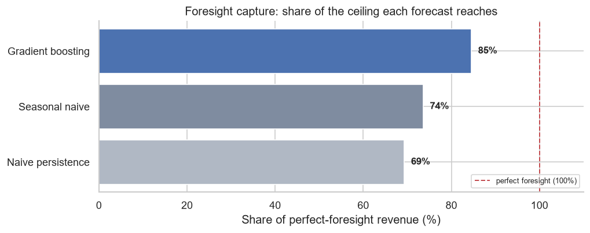
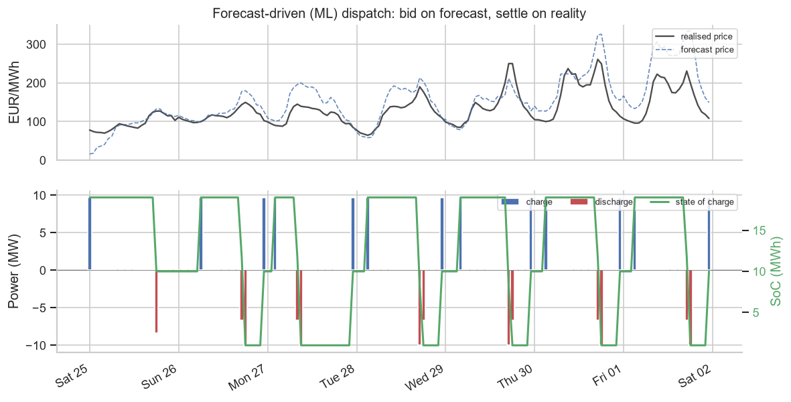
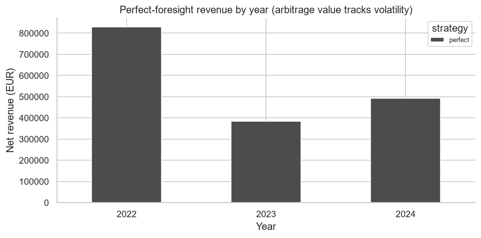
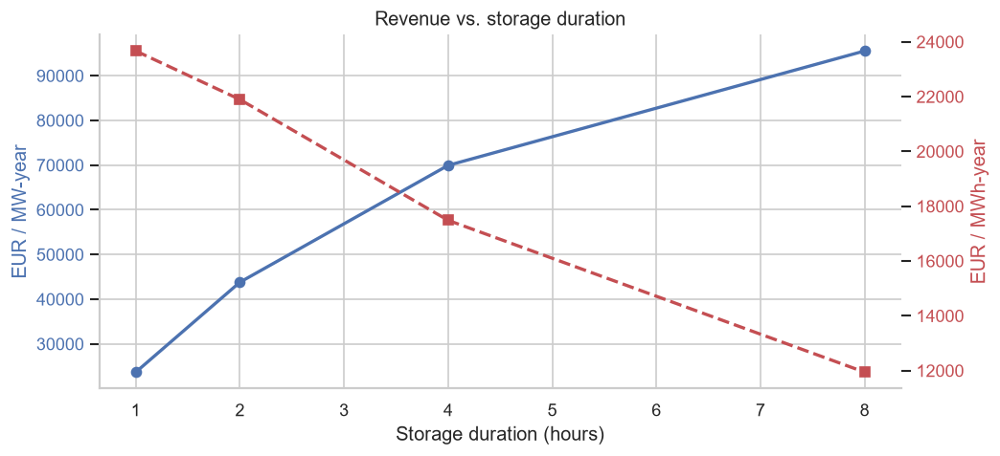

# BESS Day-Ahead Dispatch Optimizer

Revenue optimization for a grid-scale battery trading energy arbitrage in the
German day-ahead market. The optimizer schedules charge and discharge against
real historical prices, and the project measures how much of the theoretical
(perfect-foresight) revenue survives once you replace clairvoyance with an
actual price forecast.

The interesting question here is not "how much can a battery earn if it knows
tomorrow's prices" (nobody does). It is "how much revenue does forecast error
cost a real operator, and what physical and economic parameters drive the rest
of the business case." Those are the numbers this repo produces.

All prices and forecasts come from [SMARD.de](https://www.smard.de/en), the
German regulator's open market-data platform. No API key or registration is
needed.

*Project developed April 2026.*

---

## Headline result

A 10 MW / 20 MWh (2-hour) battery running pure day-ahead energy arbitrage over
2023–2024, with each schedule valued against realised prices:

| Strategy | EUR / MW-year | Foresight capture |
|---|--:|--:|
| Perfect foresight (theoretical ceiling) | 43,782 | 100% |
| **Gradient-boosting forecast** | **37,016** | **84.5%** |
| Seasonal-naive forecast | 32,227 | 73.6% |
| Naive persistence | 30,354 | 69.3% |



The capture ratio is the result that matters, not the perfect-foresight number.
A gradient-boosting price forecast captures about 85% of the theoretical
ceiling; a "tomorrow looks like today" rule captures 69%. The gap between them
is the revenue that better forecasting is worth.

There is a second, subtler result worth calling out. A naive operator *expects*
to earn €876k, because it optimizes against a forecast whose price spreads look
just as wide as reality's. It actually collects €608k once real prices settle,
a 31% shortfall it never anticipated. The backtest reports both the planned and
the settled figure, so this optimism gap is measured rather than hidden.

---

## What the battery does

Every hour the optimizer decides whether to charge, discharge, or sit idle,
subject to power and state-of-charge limits, round-trip efficiency, a daily
cycle budget, and a per-MWh degradation cost. One week of forecast-driven
dispatch: the battery buys in the cheap overnight and midday-solar troughs and
sells into the morning and evening peaks, while its state of charge stays inside
the 5–95% band.



---

## The three stages

The project is built in three self-contained stages.

### Stage 1: perfect-foresight ceiling

Optimize each day against the prices that actually occurred. This is the
theoretical maximum, useful only as a yardstick. Across 2022–2024 the ceiling
averages **EUR 56,817 / MW-year**, but it moves sharply with market volatility:

| Year | Market regime | EUR / MW-year (ceiling) |
|---|---|--:|
| 2022 | Gas crisis, extreme spreads | 82,924 |
| 2023 | Prices normalising | 38,514 |
| 2024 | Calmer, more negative-price hours | 49,170 |



A strategy that only earns money in a crisis year is not a strategy, which is
why the backtest spans several price regimes.

### Stage 2: realistic, forecast-driven operation

Real operators bid into the day-ahead auction before the 12:00 gate closure,
using a forecast of tomorrow's prices. The backtest reproduces that sequence:

1. On day *D* at noon, forecast prices for day *D+1*.
2. Optimize the schedule against the forecast.
3. Settle that committed schedule against the realised prices.
4. Roll forward, carrying the real state of charge.

Because the power schedule and the battery physics are both deterministic,
forecast error affects revenue but never feasibility, exactly as in the real
auction. Three forecasts are compared against the ceiling:

- **Naive persistence:** tomorrow equals today.
- **Seasonal naive:** tomorrow equals the same weekday last week.
- **Gradient boosting** (`HistGradientBoostingRegressor`): trained walk-forward
  on calendar features, day-ahead load / wind / solar forecasts, residual load,
  and price lags. It is retrained every 30 days on an expanding window, so no
  information from the delivery day ever enters training.

### Stage 3: duration sweep

Hold power at 10 MW and vary energy so the battery becomes a 1h / 2h / 4h / 8h
system (perfect foresight, 2023–2024):

| Duration | EUR / MW-year | EUR / MWh-year | Cycles / year |
|---|--:|--:|--:|
| 1h | 23,664 | 23,664 | 430 |
| 2h | 43,782 | 21,891 | 411 |
| 4h | 69,926 | 17,482 | 340 |
| 8h | 95,522 | 11,940 | 234 |

Revenue per MW keeps climbing as you add hours (more energy to shift), but
revenue per MWh, which is what the energy capex is spent on, falls steeply. The
first hours of storage capture the wide daily spread; each additional hour
chases smaller intraday movements. Whether 2h or 4h is optimal therefore depends
on the ratio of power cost to energy cost, not on revenue alone. This is one
reason most merchant batteries in Germany are built at 1–2 hours.



---

## Running it

See [RUNNING.md](RUNNING.md) for step-by-step setup, including a VS Code walk-
through. The short version:

```bash
pip install -r requirements.txt
python scripts/run_all.py      # downloads data once, then runs all three stages
```

Individual stages:

```bash
python scripts/download_data.py         --start 2022-01-01 --end 2025-01-01
python scripts/run_perfect_foresight.py --start 2022-01-01 --end 2025-01-01
python scripts/run_backtest.py          --data-start 2022-01-01 --start 2023-01-01 --end 2025-01-01
python scripts/run_duration_sweep.py    --start 2023-01-01 --end 2025-01-01
```

Tests:

```bash
pytest
```

---

## Two modelling details that are easy to get wrong

Both are demonstrated in the test suite.

### The charge/discharge binary is not optional

A common shortcut drops the binary `u[t]` that stops the battery charging and
discharging in the same hour, on the grounds that round-trip losses make
simultaneous charge and discharge unprofitable, so a linear program enforces it
for free. That argument fails as soon as prices turn negative, and Germany had
**827 negative-price hours in 2022–2024** (3.1% of all hours, with a −500 EUR/MWh
floor). At a negative price the solver is paid to consume, so without the binary
it will run a charge-then-discharge loop that deliberately wastes energy through
the round-trip losses to increase net consumption. The result is physically
meaningless but numerically optimal. The binary rules it out.
See `tests/test_optimizer.py::test_binary_prevents_negative_price_loop`.

### Terminal state of charge

Optimize a single day with no end condition and the model empties the battery in
the final hour, because stored energy has no value past the horizon. That
inflates revenue by selling the starting charge for free. A cyclic terminal
constraint `e[T] = e[0]` fixes it.
See `tests/test_optimizer.py::test_terminal_constraint_prevents_draining`.

---

## The model

Decision variables per hour *t*: charge power `p_ch[t]`, discharge power
`p_dis[t]`, state of charge `e[t]`, and the binary `u[t]` (1 when charging).

Objective (maximise):

```
sum_t  price[t] * (p_dis[t] - p_ch[t]) * dt   -   c_deg * p_dis[t] * dt
```

Constraints:

```
e[t] = e[t-1] + eta_ch * p_ch[t] * dt - p_dis[t] * dt / eta_dis   (SoC dynamics)
E_min <= e[t] <= E_max                                             (SoC bounds)
0 <= p_ch[t]  <= P_max * u[t]                                      (charge gate)
0 <= p_dis[t] <= P_max * (1 - u[t])                                (discharge gate)
sum_t p_dis[t] * dt <= cycle_limit                                (throughput cap)
e[last] = e[0]                                                     (cyclic terminal)
```

**Solver.** [PuLP](https://coin-or.github.io/pulp/) with CBC. CBC ships inside
PuLP, so the model solves with no extra solver install, which keeps the repo
reproducible. The formulation is a small MILP (about 100 variables per day) and
swaps cleanly to HiGHS or Gurobi if preferred.

**Why a MILP rather than a greedy rule.** A greedy "charge below the median,
discharge above it" heuristic cannot respect a global daily cycle budget, cannot
co-optimize the terminal state of charge, and has no clean way to price marginal
degradation into individual trades. The MILP handles all three at once and is
still tiny to solve. Dynamic programming over a discretised SoC grid is a
reasonable alternative for a single battery, but it becomes awkward once a second
coupled market is added (for example the frequency-regulation extension), where
the MILP only gains a few constraints.

**Degradation cost, derived rather than assumed:**

```
c_deg [EUR/MWh discharged] = replacement_cost_per_kWh * 1000
                             / (cycle_life * depth_of_discharge)
```

With the [config](config/battery.yaml) defaults (120 EUR/kWh, 8000 cycles, 90%
depth of discharge) this works out to about **16.7 EUR/MWh**, the hurdle a round
trip has to clear to be worth the wear. Cell prices fall quickly, so this is an
assumption to keep current, not a constant, which is why it lives in the YAML
rather than the code.

---

## Data

| Field | Source | SMARD series ID |
|---|---|--:|
| Day-ahead price (DE/LU) | EPEX SPOT via SMARD | 4169 |
| Day-ahead load forecast | German TSOs via SMARD | 411 |
| Day-ahead solar forecast | German TSOs via SMARD | 125 |
| Day-ahead onshore wind forecast | German TSOs via SMARD | 123 |
| Day-ahead offshore wind forecast | German TSOs via SMARD | 3791 |

- **SMARD.de** (Bundesnetzagentur / German Federal Network Agency),
  open data portal: <https://www.smard.de/en>
- Market data download centre and terms of use:
  <https://www.smard.de/en/downloadcenter/download-market-data/>
- Day-ahead prices are set by [EPEX SPOT](https://www.epexspot.com/en) market
  coupling for the German-Luxembourg bidding zone.

The forecast fields are genuine day-ahead forecasts published before gate
closure, so using them to predict the next day's price introduces no lookahead.

**A note on the series IDs.** SMARD addresses each series by a numeric ID, and
the ID lists circulating online are frequently mislabeled. Every ID above was
checked by correlating the day-ahead forecast against SMARD's own realised
generation over June 2024:

| Series | ID | Correlation vs. realised |
|---|--:|--:|
| Load forecast | 411 | 0.98 |
| Solar forecast | 125 | 0.99 |
| Onshore wind forecast | 123 | 0.96 |
| Offshore wind forecast | 3791 | 0.81 |

Two IDs from the usual lists turned out to be wrong (one supposed wind series
tracked nothing physical, and an "offshore" ID was actually onshore), which is
why the IDs are validated in code rather than trusted.

---

## Repository layout

```
bess-dispatch-optimizer/
├── config/battery.yaml     # every physical and economic assumption (no magic numbers in code)
├── src/bess/
│   ├── config.py           # typed config and derived quantities (efficiency, c_deg, bounds)
│   ├── data/smard.py       # SMARD client with on-disk caching
│   ├── forecast/models.py  # perfect / naive / seasonal / gradient boosting
│   ├── optimize/dispatch.py# the MILP and settlement
│   ├── backtest/rolling.py # rolling-horizon "bid on forecast, settle on reality"
│   └── analysis/           # metrics and plots
├── scripts/                # data download, one script per stage, run_all
├── tests/                  # energy balance, SoC bounds, binary, cycle cap, hand-checked revenue
├── notebooks/              # exploratory scripts
└── results/                # generated charts and summary CSVs
```

---

## Metrics reported

- Revenue per MW-year and per MWh-year
- Equivalent full cycles per year
- Foresight capture ratio (realistic / perfect)
- Revenue split by price regime (2022 / 2023 / 2024)
- Simple payback for a stated capex assumption

---

## Possible extensions

- **Frequency-regulation stacking.** Commit capacity to FCR in 4-hour blocks
  (unavailable for arbitrage, with a prequalification headroom constraint),
  using auction data from [regelleistung.net](https://www.regelleistung.net).
- **Cross-market comparison.** Run the same battery against DE, FR, NL and ES
  prices to show that market structure, not technology, drives returns, using
  the [ENTSO-E Transparency Platform](https://transparency.entsoe.eu).
- **Intraday continuous.** Re-optimize against intraday prices after the
  day-ahead gate to recover part of the forecast-error gap.

---

## Limitations

- Day-ahead only, with no intraday re-optimization, so the forecast-error gap is
  an upper bound on what a real desk leaves on the table.
- Price-taker assumption: the battery's own bids do not move the clearing price
  (reasonable at 10 MW, not at 1 GW).
- Perfect availability and prequalification; no outages or SoC-estimation error.
- Degradation is a single per-MWh throughput cost, not a full rainflow or
  calendar-ageing model.

---

## Author

**Mohammad Faisal**, M.Sc. Power Engineering (Renewable Energy)

- GitHub: [github.com/CodingxFaisal](https://github.com/CodingxFaisal)
- Email: mohammad.faisal@gmx.de

## License

Released under the MIT License. See [LICENSE](LICENSE).

Data belongs to SMARD.de / Bundesnetzagentur and is used under their terms; see
the download-centre link above.
