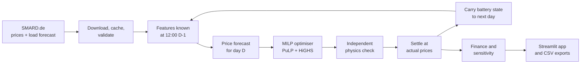

# GridFlex

**Battery energy storage (BESS) dispatch optimisation and day-ahead market research for the German–Luxembourg (DE-LU) electricity market.**

GridFlex answers a practical question: *how much money can a grid-scale battery earn by trading on the day-ahead electricity market, and how much of that depends on how well it forecasts prices?*

It downloads real German market data, forecasts the next day's prices using only information that was public at bidding time, and computes the most profitable charge/discharge plan that the battery can physically deliver. It then settles that plan against the prices that actually cleared, every day over almost two years, and reports revenue, cycling, financial metrics and sensitivities. Each number is traced back to its source data, configuration and code version.

[](https://www.python.org/)
[](LICENSE)
[](https://www.smard.de/)
[](https://github.com/CodingxFaisal/bess-dispatch-optimizer/actions/workflows/ci.yml)

> Historical backtest revenue is **not** a forecast of future revenue. Read [Limitations](#limitations) before quoting any number.

---

## Contents

- [What it does](#what-it-does)
- [Key results](#key-results)
- [How it works](#how-it-works)
- [Quick start](#quick-start)
- [Running the full study](#running-the-full-study)
- [The web app](#the-web-app)
- [Configuration](#configuration)
- [Testing and quality](#testing-and-quality)
- [Reproducibility](#reproducibility)
- [Limitations](#limitations)
- [Project structure](#project-structure)
- [Documentation](#documentation)
- [Data, attribution and licences](#data-attribution-and-licences)
- [Project history](#project-history)
- [Author](#author)

---

## What it does

A battery earns money on the day-ahead market by **buying electricity when it is cheap and selling it when it is expensive** (energy arbitrage). Doing this well requires solving three problems at once:

1. **Forecasting.** Bids for tomorrow close at 12:00 today, before tomorrow's prices are known.
2. **Optimisation.** Find the schedule that maximises value within the battery's power, energy, efficiency and cycling limits.
3. **Honest evaluation.** Measure what that schedule *really* earns at the prices that cleared, without accidentally using information from the future.

GridFlex implements all three and compares five strategies under identical conditions:

| Strategy | Price information | How the schedule is made |
|---|---|---|
| **Perfect foresight** | Actual prices (impossible in practice) | Optimiser. The upper bound on revenue |
| **GBR forecast + optimiser** | Gradient-boosting forecast | Optimiser |
| **Lasso forecast + optimiser** | LEAR-style Lasso forecast | Optimiser |
| **Persistence + optimiser** | Yesterday's prices | Optimiser |
| **Persistence + heuristic** | Yesterday's prices | Simple rule: charge in the cheapest block, discharge in the dearest |

It is built to answer five research questions:

1. How much does a forecast-driven battery strategy earn under realistic constraints?
2. How much value is lost relative to perfect foresight?
3. How do power, energy capacity, efficiency, degradation and cycling limits affect results?
4. Does uncertainty-aware optimisation improve realised performance? *(Not yet answered: only point forecasts are implemented.)*
5. Which assumptions materially change the financial conclusions?

---

## Key results

The default battery is **10 MW / 20 MWh** (2 hours), with 86 % round-trip efficiency and a 5–95 % state-of-charge window. It is limited to 1.5 full cycles per day and charged a degradation cost per MWh discharged. All results cover the **hold-out period of 1 January 2024 to 30 September 2025 (639 days)**. That period was not used to select any model.

**Price forecast accuracy**:

| Model | MAE (EUR/MWh) | Relative to seasonal naive |
|---|--:|--:|
| Gradient boosting (GBR) | **22.18** | 0.682 |
| Lasso, LEAR-style | 22.44 | 0.690 |
| Persistence (yesterday) | 27.07 | 0.832 |
| Seasonal naive (last week) | 32.55 | 1.000 |

GBR and Lasso are statistically indistinguishable (Diebold-Mariano p = 0.30). Source: [RESULTS §1](docs/RESULTS.md#1-day-ahead-price-forecast-accuracy).

**Battery revenue over 639 days**:

| Strategy | Net operating revenue (EUR) | EUR per MW per year | Share of perfect foresight | Loss-making days |
|---|--:|--:|--:|--:|
| Perfect foresight (benchmark) | 942,903 | 53,859 | 100 % | 0 |
| Lasso + optimiser | 790,226 | 45,138 | 83.8 % | 57 |
| GBR + optimiser | 781,601 | 44,645 | 82.9 % | 60 |
| Persistence + optimiser | 712,570 | 40,702 | 75.6 % | 75 |
| Persistence + heuristic | 407,114 | 23,255 | 43.2 % | 88 |

Sources: [RESULTS §2](docs/RESULTS.md#2-day-ahead-dispatch-backtest-hourly-regime) and [§3](docs/RESULTS.md#3-financial-metrics-and-sensitivity).

**What this shows:**

- **Good forecasts are worth about 8 percentage points** of the benchmark compared with using yesterday's prices.
- **The optimiser matters more than the forecast.** With the same forecast, it earns 1.75× the simple heuristic.
- **Battery duration and degradation cost dominate the economics.** A 4-hour battery earns about 1.65× more per MW than a 2-hour one. Doubling the degradation cost removes about 27 % of forecast-driven revenue ([RESULTS §3.3](docs/RESULTS.md#33-sensitivity-one-at-a-time-perfect-foresight-and-gbr--milp)).

These figures are **net operating revenue**: market revenue minus degradation cost. They are **not profit**, because capital cost, O&M, grid fees, taxes and financing are excluded. The degradation cost is a placeholder without a cited source; see [Limitations](#limitations).

---

## How it works



### 1. Market data
- **Source:** the German regulator's [SMARD.de](https://www.smard.de/) platform. GridFlex uses the DE-LU day-ahead price (series 4169) and the day-ahead grid-load forecast (series 411), hourly from 2021 to September 2025.
- **Download and cache:** every download is cached byte-for-byte with a SHA-256 checksum and a provenance record, so later runs can work offline. Requests use timeouts and bounded retries.
- **Validation:** the data is checked for gaps, duplicates, timestamps off the time grid, resolution changes, values outside the legal price limits, and the 23- and 25-hour clock-change days. **Nothing is ever filled in or invented**: a gap in prices stops the run.
- **Units:** SMARD reports load as MWh per interval, which GridFlex converts to average MW.

### 2. Information timing (no look-ahead)
Day-ahead bids for day D close at **12:00 (Berlin time) on D−1**. Every input carries the time it was published, and guards raise an error if a forecast tries to use anything published later.

| Input | Published | Used? |
|---|---|---|
| Prices up to D−1 | 13:00 on D−2 or earlier | yes |
| Load forecast for D | about 10:00 on D−1 | yes |
| Solar and wind forecasts for D | about 18:00 on D−1 | **no**: after the deadline |

A test corrupts all data after the decision time and checks that the forecasts stay identical, bit for bit.

### 3. Price forecasting
Four models predict all 24 hourly prices of day D:

- **Persistence:** yesterday's price at the same clock time.
- **Seasonal naive:** last week's price at the same clock time. Accuracy is reported relative to this benchmark.
- **LEAR-style Lasso:** a regularised linear model on lagged prices, the load forecast and calendar effects. Prices are transformed with an inverse hyperbolic sine, and the model is re-trained daily on a rolling 2-year window.
- **Gradient boosting (GBR):** scikit-learn's `HistGradientBoostingRegressor` on the same features, re-trained weekly.

All preprocessing is fitted on training data only. Configurations were chosen on 2023, and the chosen ones were then scored **once** on the 2024–2025 hold-out using MAE, RMSE, relative MAE and Diebold-Mariano tests.

### 4. Battery model
The battery's stored energy follows the state equation

$$E_t = E_{t-1} + \eta^{ch} P^{ch}_t \Delta t - \frac{P^{dis}_t \Delta t}{\eta^{dis}}$$

The model applies:
- power limits at the grid connection;
- the state-of-charge window;
- separate charge and discharge efficiencies, each √0.86 for a round-trip of 0.86;
- interval lengths that handle 23- and 25-hour days;
- a daily cycle cap;
- degradation cost per MWh leaving the cells;
- a choice of end-of-day policy (return to start, fixed level, or a valued free level).

An **independent feasibility checker** re-simulates every schedule and rejects any that breaks a limit.

### 5. Optimisation
Each day is a mixed-integer linear program (MILP):

$$\max \sum_t \pi_t \left(P^{dis}_t - P^{ch}_t\right)\Delta t \;-\; c^{deg} \sum_t \frac{P^{dis}_t \Delta t}{\eta^{dis}}$$

The constraints are the state equation, the power and energy bounds, the cycle cap, the end-of-day energy, and a binary variable per interval that forbids charging and discharging at the same time. That binary matters at negative prices, where a linear relaxation would "burn" energy through losses for profit.

The model is built with **PuLP** and solved with **HiGHS**. A schedule is accepted only if:

- HiGHS's own status proves optimality;
- the independent physics check passes;
- the recomputed objective matches the solver's.

This matters because PuLP reports time-limited, unproven solutions as "Optimal".

### 6. Rolling backtest and settlement
The engine runs one cycle per delivery day:

1. **Decide** at D−1 12:00 with that day's information.
2. **Commit** the full-day schedule.
3. **Verify** it physically.
4. **Settle** it at the realised prices.
5. **Carry** the physically simulated end-of-day energy into D+1.

A day whose plan fails is committed idle and flagged; it is never counted as an optimised result. Planned (forecast) value and realised value are reported separately. Every run saves metadata: git commit and dirty flag, configuration fingerprint, package versions and data provenance.

### 7. Finance and sensitivity
- **Standard metrics:** annualised revenue on a 365-day basis, EUR per MW-year, EUR per MWh-year, cycles per day, and monthly and yearly tables with incomplete periods flagged.
- **Forecast capture ratio:** strategy revenue ÷ perfect-foresight revenue over the same days.
- **Payback and NPV:** computed only when capital and O&M costs are configured. By default they are not, so no payback is claimed.
- **Sensitivity:** one assumption varied at a time across power, duration, efficiency, degradation cost and the cycle cap. Each variant is a full 639-day backtest.

Full equations: [docs/MATHEMATICAL_MODEL.md](docs/MATHEMATICAL_MODEL.md). Full protocol: [docs/BACKTEST_METHODOLOGY.md](docs/BACKTEST_METHODOLOGY.md).

---

## Quick start

**Requirements:** Python 3.12 and [uv](https://docs.astral.sh/uv/getting-started/installation/). uv installs Python 3.12 itself if needed. No API keys or accounts are needed.

```bash
git clone https://github.com/CodingxFaisal/bess-dispatch-optimizer.git
```

```bash
cd bess-dispatch-optimizer
```

```bash
uv sync
```

`uv sync` creates `.venv/` with the exact package versions from `uv.lock`. Both solvers (HiGHS and CBC) are installed as Python packages, with no separate install.

**Run the tests** (offline, about 1 minute):

```bash
uv run pytest
```

**Run the one-command example** (offline, a few seconds):

```bash
uv run python scripts/run_example.py
```

This runs the **entire pipeline** on a small extract of real SMARD data that ships with the repository (9 delivery days around the March 2024 clock change):

- data validation;
- forecasts with leakage checks;
- optimised dispatch with verification;
- settlement, finance and sensitivity.

It writes `runs/example/`. Its numbers demonstrate the workflow and are not research results.

**Open the example in the web app.** In PowerShell (Windows):

```powershell
$env:GRIDFLEX_RUN_DIR = "runs/example"
```

In bash (macOS, Linux, Git Bash):

```bash
export GRIDFLEX_RUN_DIR=runs/example
```

Then start the app:

```bash
uv run streamlit run app/streamlit_app.py
```

Your browser opens at <http://localhost:8501>.

**Using VS Code:**
1. Open the folder.
2. Run `uv sync` in the integrated terminal.
3. Choose the `.venv` interpreter (**Ctrl+Shift+P → Python: Select Interpreter**).
4. Run the commands above in the terminal.

**Without uv:**

```bash
python -m venv .venv
```

```bash
.venv/Scripts/python -m pip install -r requirements-dev.txt -e .
```

On macOS or Linux, use `.venv/bin/python` instead.

---

## Running the full study

These commands reproduce everything in [docs/RESULTS.md](docs/RESULTS.md). They take about 20 minutes and need internet access for the first command only.

```bash
uv run python scripts/download_data.py --start 2021-01-01 --end 2025-10-01
```

```bash
uv run python scripts/evaluate_forecasts.py --offline
```

```bash
uv run python scripts/run_backtest.py --offline
```

```bash
uv run python scripts/run_finance.py
```

```bash
uv run python scripts/run_sensitivity.py --offline
```

| Step | What it does | Typical time |
|---|---|--:|
| `download_data.py` | Downloads and validates SMARD prices and load forecasts into `data/cache/` | 35 s |
| `evaluate_forecasts.py` | Selects forecast models on 2023 and scores them once on the hold-out | 6 min |
| `run_backtest.py` | Runs all five strategies over 639 days | 3–9 min |
| `run_finance.py` | Computes financial metrics; refuses a backtest made with a different config | seconds |
| `run_sensitivity.py` | One-at-a-time sensitivity: 17 variants × 2 strategies, each a full 639-day backtest | 8–15 min |

Outputs go to `runs/latest/` as CSV files, each folder with a `metadata.json`. Then open the app without `GRIDFLEX_RUN_DIR` to view them:

- PowerShell: `Remove-Item Env:GRIDFLEX_RUN_DIR`
- bash: `unset GRIDFLEX_RUN_DIR`

Options, flags and troubleshooting are in [RUNNING.md](RUNNING.md).

---

## The web app

`app/streamlit_app.py` is a **read-only viewer** of saved runs. It never runs models itself, and a test enforces that it imports no modelling code. It has six pages:

| Page | Shows |
|---|---|
| Overview | Revenue per strategy, methodology warnings, battery configuration, throughput and cycles, solver status, data freshness |
| Market data | Price history with negative prices, negative-price hours per month, load forecast, data-quality diagnostics |
| Forecast evaluation | MAE/RMSE per model, forecast vs actual, error distribution, Diebold-Mariano tests |
| Dispatch | Price, charge/discharge and state of charge for any day and strategy; solver and constraint diagnostics |
| Financial analysis | Revenue and cost breakdown, monthly and annual tables, battery duration and sensitivity charts, investment status |
| Experiment comparison | Strategies side by side, cumulative revenue, downloads (CSV, YAML config, JSON metadata) |

Every chart states its units, time range and timezone. You can download the tables as CSV, the run configuration as YAML and the run metadata as JSON.

---

## Configuration

All assumptions live in one validated file, [configs/default.yaml](configs/default.yaml). Unit names are part of every field name (for example `charge_power_mw` and `replacement_cost_eur_per_kwh`), and invalid values are rejected when the file is loaded.

| Section | Contents |
|---|---|
| `battery` | Power, capacity, SoC limits, efficiency, cycle cap, degradation, end-of-day policy, availability |
| `market` | Bidding zone, timezone, 12:00 gate closure, hourly vs 15-minute periods, legal price limits by date |
| `data` | SMARD series, publication times, cache and retry settings |
| `optimization` | Solver (HiGHS or CBC), MIP gap, time limit, threads |
| `forecasting` | Selection and hold-out periods, model grids |
| `backtest` | Period and strategies |
| `economics` | Trading cost and investment inputs (empty by default) |
| `sensitivity` | Values tried in the sensitivity analysis |

After editing it, rerun `run_backtest.py` and then `run_finance.py`.

---

## Testing and quality

```bash
uv run pytest
```

```bash
uv run ruff check src tests scripts notebooks app
```

```bash
uv run ruff format --check src tests scripts notebooks app
```

```bash
uv run mypy
```

| Area | What is tested |
|---|---|
| **Coverage** | 452 tests, 98 % line coverage, all offline using a committed SMARD extract. Live SMARD contract tests are opt-in: `uv run pytest -m network` |
| **Battery physics** | Hand-calculated cases for the state equation, efficiencies, irregular interval lengths, limits, cycle counting, degradation and end-of-day policies |
| **Optimisation** | Negative, zero and flat prices; a brute-force cross-check; infeasible, time-limited and solver-error cases |
| **Forecasting** | Leakage: future features raise, and future training rows raise; preprocessing is fitted on training data only; the corruption test |
| **Backtest** | Settlement by hand; failed days are never counted as optimised; battery state carried between days |
| **Finance** | Every formula, flags for partial years, investment metrics only with inputs |
| **App** | Every page renders; every chart is labelled; the app imports no modelling code |
| **Integration** | The one-command example runs end to end as a separate process |

GitHub Actions (`.github/workflows/ci.yml`) runs Ruff, mypy and pytest on Ubuntu and Windows on every push to `main` and every pull request. The first run, on the merge of the rebuild, passed on both: 452 tests each ([docs/VALIDATION.md](docs/VALIDATION.md)).

---

## Reproducibility

- **Locked environment:** exact versions in `uv.lock`, mirrored in `requirements.txt` and `requirements-dev.txt`. A test checks that they stay in sync.
- **Determinism:** single-threaded solver, fixed random seeds.
- **Traceable runs:** each run records the git commit, whether the tree was modified, the config fingerprint, package versions and data provenance.
- **Verified from scratch:**
  1. a fresh clone of a committed version;
  2. `uv sync --locked` into a new environment;
  3. an empty data cache;
  4. the full study.

  Every output table matched the recorded results **exactly** ([docs/VALIDATION.md](docs/VALIDATION.md), Stage 9).
- **Separated outputs:** example and new results go to the git-ignored `runs/`. Only the small test fixture and the labelled legacy outputs are committed.

---

## Limitations

The most important ones (full list: [docs/LIMITATIONS.md](docs/LIMITATIONS.md)):

- **Day-ahead market only.** No intraday trading, balancing reserves (FCR/aFRR) or imbalance settlement.
- **Fixed schedules.** Each day's plan is executed at whatever price clears. Real bids are price-dependent curves.
- **Price taker.** The battery's bids do not move prices.
- **The degradation cost (16.67 EUR per MWh discharged) is an unsourced placeholder.** It changes revenue by up to a factor of 1.85 in the sensitivity analysis. Replace it with a cited value before relying on absolute figures.
- **Simplified battery.** Linear degradation, constant efficiency, no calendar ageing, no outages, no self-discharge.
- **Single forecast vintage.** SMARD stores one version of each load forecast, so later revisions cannot be ruled out.
- **Point forecasts only.** Research question 4 (uncertainty-aware dispatch) is open.
- **Hourly period only so far.** The 15-minute market from 1 October 2025 is supported in the data layer but not yet evaluated.
- **Not profit, not a prediction.** Revenue excludes capital and operating costs, and past market conditions will change.

---

## Project structure

```
configs/default.yaml        every physical, market, data and economic assumption
src/gridflex/
  config/                   validated configuration models, config fingerprint
  data/                     SMARD client, raw cache, cleaning, validation, publication times
  battery/                  physics: state equation, cycles, degradation, feasibility checker
  optimization/             MILP (PuLP + HiGHS), solve reports, verification
  forecasting/              features with publication times, four models, evaluation, DM test
  settlement/               settlement of committed schedules
  backtest/                 rolling day-ahead engine, strategies, heuristic
  finance/                  financial metrics, investment metrics, sensitivity
  reporting/                run metadata, exports, Plotly figures, offline example
scripts/                    command-line entry points (download, evaluate, backtest, finance, ...)
app/                        Streamlit viewer (read-only)
tests/                      unit, property, fixture and integration tests
docs/                       full documentation (below)
notebooks/                  exploratory price analysis (VS Code / Jupyter cells)
results/legacy_v0.1.0/      withdrawn v0.1 outputs, kept for traceability
```

The architecture, dependency direction and correctness boundaries are described in [docs/ARCHITECTURE.md](docs/ARCHITECTURE.md).

---

## Documentation

| Document | Contents |
|---|---|
| [RUNNING.md](RUNNING.md) | Installation, all commands and flags, troubleshooting |
| [docs/ARCHITECTURE.md](docs/ARCHITECTURE.md) | Data flow, packages, correctness boundaries, technology |
| [docs/DATA_DICTIONARY.md](docs/DATA_DICTIONARY.md) | Series, units, timestamps, publication times, validation rules |
| [docs/MATHEMATICAL_MODEL.md](docs/MATHEMATICAL_MODEL.md) | Battery physics and the optimisation model |
| [docs/BACKTEST_METHODOLOGY.md](docs/BACKTEST_METHODOLOGY.md) | Forecasting protocol, rolling backtest, settlement |
| [docs/RESULTS.md](docs/RESULTS.md) | All results, with the command and code version behind each |
| [docs/VALIDATION.md](docs/VALIDATION.md) | Test results and clean-environment checks |
| [docs/LIMITATIONS.md](docs/LIMITATIONS.md) | What is not modelled and how it affects the results |
| [docs/AUDIT.md](docs/AUDIT.md) | Audit of v0.1, defect register and how each defect was resolved |

---

## Data, attribution and licences

**Market data:** **Bundesnetzagentur | SMARD.de**, licensed [CC BY 4.0](https://creativecommons.org/licenses/by/4.0/). Downloaded data is not committed. The small test fixture in `tests/fixtures/smard_cache/` is an unmodified SMARD extract under the same licence.

**Methodological references.** No code was copied from either:
- [PyPSA](https://github.com/PyPSA/PyPSA) (MIT): storage state-of-charge formulation and per-period weighting.
- [epftoolbox](https://github.com/jeslago/epftoolbox) (Apache-2.0): the LEAR forecasting benchmark and evaluation methodology. Lago, J., Marcjasz, G., De Schutter, B., Weron, R. (2021). *Forecasting day-ahead electricity prices: A review of state-of-the-art algorithms, best practices and an open-access benchmark.* Applied Energy 293, 116983.

**Main dependencies:**

| Licence | Packages |
|---|---|
| MIT | PuLP, HiGHS (`highspy`), pydantic, PyYAML, Plotly |
| EPL-2.0 | CBC (bundled with PuLP) |
| BSD-3 | pandas, NumPy, SciPy, scikit-learn |
| Apache-2.0 | Streamlit |

**This project:** MIT licence, see [LICENSE](LICENSE). Data remains under its own licence.

---

## Project history

This repository began as **bess-dispatch-optimizer v0.1.0**. An audit ([docs/AUDIT.md](docs/AUDIT.md)) found that its headline result, a forecast strategy capturing "84.5 %" of perfect-foresight revenue, used solar and wind forecasts that are only published *after* the bidding deadline. Without that look-ahead, the same model captured 70.8 %, below a simple seasonal-naive forecast.

The claim is **withdrawn**, and the old outputs are kept, clearly labelled, in [results/legacy_v0.1.0/](results/legacy_v0.1.0/README.md). The project was then rebuilt step by step as GridFlex (version 0.2.0.dev0), with the safeguards described above. Each step was tested and documented in [docs/VALIDATION.md](docs/VALIDATION.md).

---

## Author

**Mohammad Faisal**, M.Sc. Power Engineering (Renewable Energy).
GitHub: [CodingxFaisal](https://github.com/CodingxFaisal)
