# Architecture

GridFlex is a small Python package (`src/gridflex`) with command-line scripts (`scripts/`) and a read-only Streamlit viewer (`app/`). Every physical, market, data and economic assumption lives in one validated configuration file (`configs/default.yaml`). Every run writes its outputs together with the metadata needed to trace them back to code, configuration and data.

## 1. Data flow

```mermaid
flowchart LR
    SMARD[(SMARD.de chart data<br/>CC BY 4.0)] -->|HTTP, retries| RAW[Raw cache<br/>bytes + SHA-256 sidecars]
    RAW --> CLEAN[clean<br/>units, duplicates]
    CLEAN --> VAL[validate<br/>gaps, DST, bounds]
    VAL --> DS[MarketDataset<br/>UTC grid, provenance]
    CFG[configs/default.yaml<br/>pydantic] --> DS
    DS --> FT[FeatureTable<br/>publication instants]
    FT -->|leakage guards| FC[Forecasters<br/>persistence / seasonal / Lasso / GBR]
    FC --> PF[PriceForecast<br/>origin + cutoffs]
    PF --> STR[Strategies]
    DS -->|realised prices,<br/>benchmark only| STR
    STR --> OPT[MILP<br/>PuLP + HiGHS]
    OPT --> CHK[Physics checker]
    CHK --> SET[Settlement<br/>realised + expected]
    SET --> CARRY[State carry<br/>state equation]
    CARRY --> STR
    SET --> OUT[Run outputs<br/>CSV + metadata.json]
    OUT --> FIN[Finance<br/>metrics, investment, sensitivity]
    FIN --> OUT
    OUT --> UI[Streamlit viewer<br/>read-only]
```



## 2. Packages and responsibilities

| Package | Responsibility | Key types / functions | Docs |
|---|---|---|---|
| `gridflex.config` | Load and validate configuration; units in field names; config fingerprint | `GridFlexConfig`, `load_config`, `config_fingerprint` | DATA_DICTIONARY |
| `gridflex.data` | SMARD client (timeouts, bounded retries, pacing), raw cache with invalidation policy, offline mode, cleaning (MWh per interval → MW), validation, information-availability registry, datasets | `SmardClient`, `RawCache`, `validate_series`, `build_market_dataset`, `available_from`, `decision_time` | DATA_DICTIONARY |
| `gridflex.battery` | Physics: state equation with per-interval durations, AC/DC throughput, EFC, degradation, terminal policies; **independent feasibility checker** | `BatteryModel`, `Schedule`, `energy_trajectory`, `throughput`, `check_schedule` | MATHEMATICAL_MODEL §2 |
| `gridflex.optimization` | Dispatch MILP (PuLP, HiGHS default), solve reports, verification of every accepted schedule | `DispatchProblem`, `build_model`, `solve_dispatch`, `SolveReport` | MATHEMATICAL_MODEL §3 |
| `gridflex.forecasting` | Feature table with publication instants, leakage guards, forecast record, four models, chronological evaluation, Diebold-Mariano test | `build_feature_table`, `PriceForecast`, `LassoForecaster`, `GbrForecaster`, `select_models`, `evaluate_holdout` | BACKTEST_METHODOLOGY §1 |
| `gridflex.settlement` | Value a committed schedule at a price vector | `settle`, `Settlement` | BACKTEST_METHODOLOGY §2.4 |
| `gridflex.backtest` | Rolling day-ahead engine (decide → commit → verify → settle → carry), strategies, two-window heuristic | `run_backtest`, `run_strategy`, `PerfectForesightStrategy`, `ForecastStrategy`, `HeuristicStrategy` | BACKTEST_METHODOLOGY §2 |
| `gridflex.finance` | Metrics with explicit formulas, period tables, capture ratio, investment metrics (only with inputs), sensitivity | `summarise`, `period_table`, `investment_metrics`, `run_sensitivity` | RESULTS §3.1 |
| `gridflex.reporting` | Run metadata, run export and loading, Plotly figures with label checks, offline example | `run_metadata`, `write_backtest_run`, `write_finance`, `load_run`, `figures`, `build_example_run` | this file |
| `app/` | Streamlit viewer of saved runs (six pages); imports only `gridflex.reporting` (enforced by test) | `streamlit_app.py`, `app_pages/*.py` | README |
| `scripts/` | Command-line entry points | `download_data`, `evaluate_forecasts`, `run_backtest`, `run_finance`, `run_sensitivity`, `run_example`, `capture_smard_fixtures` | RUNNING |

**Dependency direction** (no cycles):

`config` → `data` → `battery` → `optimization` → `forecasting` → `settlement` → `backtest` → `finance` → `reporting` → `app`

Each layer only imports layers to its left, except `reporting.metadata`, which the backtest uses for run metadata.

## 3. Boundaries that protect correctness

| Boundary | Mechanism | Test evidence |
|---|---|---|
| No information from after the decision instant | Every feature and target carries its publication instant; guards raise `InformationLeakageError`; only the benchmark receives realised prices | Forecasts stay bit-for-bit identical when all post-origin data is corrupted (`tests/forecasting/test_leakage.py`) |
| No invented data | Cleaning never fills; validation reports; datasets abort on price gaps; forecasts raise on missing inputs | `tests/data/*`, `test_missing_*` |
| No unverified schedule is settled as optimised | Solver status from HiGHS's native status; independent physics check; objective recomputation; failed days committed idle and flagged | `tests/optimization/test_failure_modes.py`, `tests/backtest/test_engine.py` |
| Physical state is consistent | Next day starts from the state-equation energy of the committed schedule | `test_physical_state_is_carried_between_days`; real run: 10.000000 MWh on all days |
| Results are traceable | `metadata.json`: git commit and dirty flag, config fingerprint and dump, package versions, data provenance; finance refuses runs with another config | `tests/reporting/test_reporting.py` |
| UI shows, never computes | `app/` may import only `gridflex.reporting` | AST test in `tests/reporting/test_reporting.py` |

## 4. Files and outputs

```
configs/default.yaml          single source of assumptions (validated)
data/cache/                   raw SMARD payloads + provenance sidecars (git-ignored)
runs/latest/                  newly computed results (git-ignored)
  forecast_evaluation/        selection, hold-out metrics, forecasts, DM tests, metadata
  backtest/                   daily, intervals, summary, market_data, metadata
  backtest/finance/           summary, by_year, by_month, capture tables, investment.json
  sensitivity/                sensitivity.csv, metadata
runs/example/                 output of scripts/run_example.py (git-ignored)
results/legacy_v0.1.0/        superseded v0.1 outputs, kept for traceability
tests/fixtures/smard_cache/   committed SMARD extract (CC BY 4.0) for offline tests
```

## 5. Technology

| Area | Choice | Licence |
|---|---|---|
| Language | Python 3.12 | PSF |
| Environment | uv with `uv.lock`; pip exports `requirements*.txt` | |
| Data | pandas, NumPy | BSD-3 |
| Config | pydantic v2, PyYAML | MIT |
| Optimisation | PuLP (modelling), HiGHS via `highspy` (default solver), CBC bundled with PuLP (alternative) | MIT; MIT; EPL-2.0 |
| Forecasting | scikit-learn (`LassoLarsIC`, `HistGradientBoostingRegressor`), SciPy | BSD-3 |
| UI and charts | Streamlit, Plotly | Apache-2.0, MIT |
| Quality | pytest, pytest-cov, Ruff, mypy; GitHub Actions on Ubuntu and Windows | MIT / Apache-2.0 |
